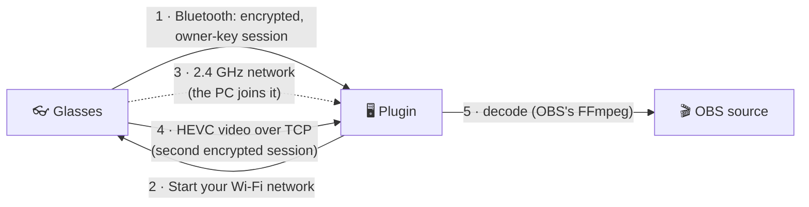

<p align="center">
  
</p>

<p align="center">
  <a href="https://github.com/RandyNorthrup/meta-g-link-direct/releases"></a>
  <a href="https://github.com/RandyNorthrup/meta-g-link-direct/actions/workflows/quality.yml"></a>
  
  
  <a href="LICENSE"></a>
</p>

Use your **Ray-Ban Meta (Gen 2)** glasses as a first-person camera in **OBS Studio** on Windows. Video comes straight from the glasses over a short-range Wi-Fi network that the glasses create for your PC. No phone, no companion app, and no router or hotspot setup.

> [!WARNING]
> **Beta.** Tested on one Windows 11 PC with one pair of glasses. The one-time setup makes this PC the glasses' owner, which disconnects them from the Meta AI phone app. Read [Before you start](#before-you-start).

## Features

- 🎥 **Live portrait video**: 720 × 1280 at 30 fps as a native OBS source.
- 📡 **Direct link**: Bluetooth for control and the glasses' own 2.4 GHz Wi-Fi network for video. Your home network isn't involved.
- ⚡ **Hands-off**: the camera starts when its scene goes live and stops when the scene leaves the program output. Starting and stopping never stall OBS.
- 🔒 **Private**: Meta is contacted only during setup. The owner key is sealed to your Windows account. No telemetry, no update checks, no recordings.

## What you need

| | |
|---|---|
| **PC** | Windows 11 x64 |
| **OBS** | OBS Studio 32.x (64-bit) |
| **Glasses** | Ray-Ban Meta Gen 2, charged |
| **Bluetooth** | An adapter that supports both Bluetooth LE and Classic |
| **Wi-Fi** | Any adapter that can join a 2.4 GHz network |
| **Account** | Your Meta account, for the one-time setup |

> [!NOTE]
> While the camera runs, the Wi-Fi adapter it uses is connected to the glasses, and that link has no internet. If you stream online, connect the PC by Ethernet. With two Wi-Fi adapters you can give the camera one of them in the source's **Wi-Fi adapter** setting and keep the other online; that setup hasn't been tested yet. Windows reconnects the adapter to your usual network when the camera stops.

## Before you start

- **Ownership moves to this PC.** The glasses accept one owner. After setup, the Meta AI phone app can't use them until you remove and add them again in Meta AI. That return trip hasn't been tested by this project yet.
- **One PC at a time.** Setting the glasses up on another PC takes them away from this one.
- **Turn off your phone's Bluetooth** during setup and use, so the glasses don't connect to it.

## 1 · Pair the glasses with your PC

Do this once, before installing. The glasses must be paired with Windows itself, not only with your phone.

1. **Turn off Bluetooth on your phone**, so the glasses don't reconnect to it.
2. **Take the glasses out of the case** and make sure they're charged and on.
3. On the PC, open **Settings → Bluetooth & devices**, make sure Bluetooth is **On**, then choose **Add device → Bluetooth**.
4. **Put the glasses in pairing mode**: fold both arms, then press and hold the **capture button** (the button you press to take a photo) for about **12 seconds**, until the light inside the frame blinks **blue**. Let go as soon as it blinks.
5. In the Windows list, choose the glasses. They appear as **RB Meta** followed by four characters (for example "RB Meta 12AB"). Accept any prompt to connect or pair.
6. Check that **RB Meta …** now appears under *Bluetooth & devices*. "Paired" is enough; it doesn't need to say "Connected".

If the glasses don't show up:

- Make sure your Bluetooth adapter supports **Bluetooth LE**. Older Classic-only adapters don't list the glasses at all.
- Put the glasses back in the case, close the lid for a few seconds, take them out and try pairing mode again.
- If they were paired with this PC before and setup now fails, remove **RB Meta …** in *Bluetooth & devices* and pair again.

## 2 · Install

1. Download `meta-g-link-direct-<version>-windows-x64.zip` from [**Releases**](https://github.com/RandyNorthrup/meta-g-link-direct/releases).
2. **Close OBS**, extract the zip, and double-click **`Install.cmd`**.
   The files aren't code-signed. If Windows SmartScreen says "Windows protected your PC", choose **More info → Run anyway**.
3. The installer checks that you have OBS 32.x with its FFmpeg libraries, copies the plugin into OBS (asking for administrator permission only if OBS is in Program Files) and the setup tool to `%LOCALAPPDATA%\MetaGLinkDirect\bin`, then offers the one-time setup below.

Optional: check the download against the `.sha256` file from the same release:

```powershell
Get-FileHash .\meta-g-link-direct-<version>-windows-x64.zip -Algorithm SHA256
```

## 3 · Make this PC the owner (one time)

When the installer asks *"Set up the glasses for this PC now?"*, answer **y** and type **YES** to confirm. A browser opens the Meta login. Log in with your Meta account. When it finishes, copy the full address from the browser's address bar and paste it into the installer window. Keep the glasses on and nearby while this runs.

To run the setup later, close OBS, open a terminal in the extracted folder and run `.\Install.cmd -Setup`. It reinstalls the same files, then goes straight to the setup.

## 4 · Use it in OBS

1. In **Sources**, click **+** and add **Ray-Ban Meta Glasses (Direct)**.
2. Make its scene live. The first frame takes about 20 seconds, because the glasses start their Wi-Fi network and the PC joins it. In Studio Mode, the camera starts when the scene goes to **Program**, not Preview.
3. Switch away from the scene to stop the camera and free your Wi-Fi adapter.

The source's **Properties** show:

- **Video quality**: 720 × 1280 (recommended), 1080 × 1920 (experimental), 504 × 896 or 360 × 640. Only 720 × 1280 has been tested so far.
- **Wi-Fi adapter**: *Automatic (first adapter)*, or a specific adapter by name. Pick the one you don't need online. If the chosen adapter is unplugged, the source reports it in the log instead of using another adapter.
- Changes to either setting apply the next time the camera starts.
- **Status**: the connection state when you open the properties (Idle, Connecting, Streaming, Reconnecting, Waiting, Failed or Stopped).

Only one glasses source streams at a time. Another one shows *Waiting* and takes over when the first leaves the program output.

## Known limits

- **Battery**: streaming drains the glasses quickly. One reading suggests about 35–40 minutes from a full charge (not yet confirmed).
- **Quality**: only 720 × 1280 at 30 fps has been verified. Glasses audio isn't implemented; use your usual OBS audio device.
- **Reconnecting** after a dropped link is implemented but hasn't been exercised on real hardware yet.
- **Security**: the PC doesn't yet verify the glasses' identity signature during the handshake.
- **Coverage**: one PC, one Bluetooth adapter, one Wi-Fi adapter and one pair of glasses. The glasses' firmware build hasn't been recorded yet.

## How it works



1. The plugin opens an encrypted Bluetooth session and proves it holds the glasses' owner key. If the glasses refuse the key, the source stops and asks for the setup again.
2. It asks the glasses to start their own 2.4 GHz / 20 MHz Wi-Fi network, with a fresh random name and password each time.
3. The PC joins that network with the chosen Wi-Fi adapter and a temporary Windows Wi-Fi profile.
4. A second encrypted session runs over TCP on that network. The camera starts and sends HEVC video.
5. The plugin decodes the video with the FFmpeg libraries that ship with OBS and hands each frame to OBS.

When the camera stops, the PC leaves the network and deletes the profile, and the glasses close the network within about 15 seconds.

Why do the glasses host the network? When the glasses instead joined a network (a Windows hotspot, or a home router), the video stopped within a minute every time. On their own network the stream holds. The details are in [the Wi-Fi link report](reports/WIFI_LINK_VERIFICATION.md).

## Troubleshooting

The OBS log (*Help → Log Files*) lists each connection step under `[meta-g-link-direct]`.

| Symptom | What to do |
|---|---|
| The glasses don't appear when pairing | See [step 1](#1--pair-the-glasses-with-your-pc): the adapter must support Bluetooth LE, the phone's Bluetooth must be off, and the light must blink blue. |
| Stuck on *Connecting* or *Reconnecting* | Check that the glasses are on, charged and in range, and that your phone's Bluetooth is off. The source keeps retrying. |
| Status *Failed*, and the log says *No stored glasses identity* or *The glasses did not accept this PC as their owner* | Run the setup again (`.\Install.cmd -Setup`, see [step 3](#3--make-this-pc-the-owner-one-time)). The second message means another PC or the phone took ownership since. |
| *This PC could not join the glasses' Wi-Fi network* | Make sure Wi-Fi is on and airplane mode is off. "No Wi-Fi adapter is available" means Windows sees no Wi-Fi adapter; "the Wi-Fi adapter chosen in the source properties is not available" means the selected adapter is unplugged, so plug it back in or pick another in **Wi-Fi adapter**. |
| *The glasses did not start their Wi-Fi network* | Their Wi-Fi may still be busy with an earlier session. The source retries; if it keeps failing, power-cycle the glasses. |
| Internet drops while the camera runs | The camera's Wi-Fi adapter is on the glasses' network (see [What you need](#what-you-need)). Use Ethernet, or try a second Wi-Fi adapter chosen in **Wi-Fi adapter** (untested). |
| *Waiting* | Another glasses source is live. It takes over when that one leaves the program output. |
| After OBS crashed mid-stream | The glasses close their network on their own within about 15 seconds. Delete any leftover `mgl-…` network in Windows Wi-Fi settings if one remains. |

To test the camera outside OBS, run the setup tool's 60-second stream check. It prints status lines and a frame count:

```powershell
& "$env:LOCALAPPDATA\MetaGLinkDirect\bin\meta-g-link-probe.exe" --stream
```

## Privacy and security

- The owner key and any imported Meta app tokens are sealed with Windows DPAPI for your account, in `%LOCALAPPDATA%\MetaGLinkDirect`. Nothing prints or logs them.
- Meta is contacted only during setup: the login and the ownership exchange. Streaming makes no Meta or internet call.
- The glasses' Wi-Fi network gets a new random name and 20-character password for every session.
- No telemetry, update checks or recordings. OBS's own recording stays under your control. Logs contain status lines only: no payloads, addresses or credentials.
- The setup tool has the Meta AI app's two public client tokens built in. They identify the app, not a person, and were already public.

## Uninstall and forget

- **Uninstall**: close OBS and double-click `Uninstall.cmd`. This removes the plugin and the setup tool and keeps the stored identity. It still removes the setup tool if OBS is already gone.
- **Forget the glasses**: before uninstalling, run `& "$env:LOCALAPPDATA\MetaGLinkDirect\bin\meta-g-link-probe.exe" --forget`; afterwards, delete `%LOCALAPPDATA%\MetaGLinkDirect`.
- **Give the glasses back to the phone**: in Meta AI, remove the glasses and add them again (not yet tested by this project).

## Build from source

See [docs/DEVELOPMENT.md](docs/DEVELOPMENT.md) for the toolchain, build commands, quality gates and project layout.

## Credits and license

- [**Visor**](https://github.com/macedonga/visor) by macedonga (AGPL-3.0): the AirShield/DataX session, Meta setup and stream protocol are ported from it.
- The glasses-hosted network messages (`CreateSoftApNetwork`) follow the Meta AI app's protocol definitions. No Meta code or binaries are included.
- OBS Studio's module API and the FFmpeg libraries that ship with OBS.

Licensed under the [GNU AGPL-3.0](LICENSE). Third-party details: [THIRD_PARTY_NOTICES.md](THIRD_PARTY_NOTICES.md).

This is an independent open-source project. It is not affiliated with, endorsed by or sponsored by Meta, Ray-Ban/EssilorLuxottica or OBS. Product names identify compatibility only.
