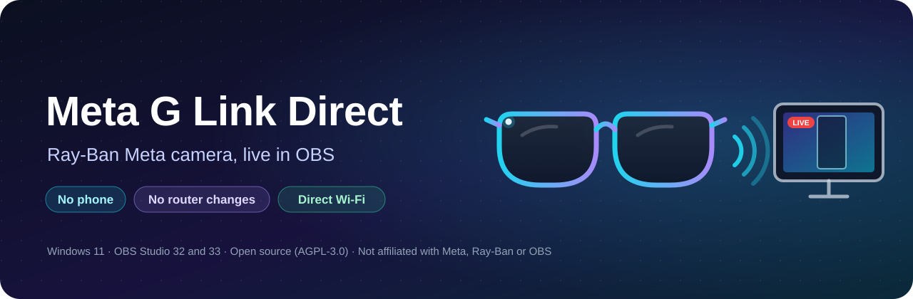
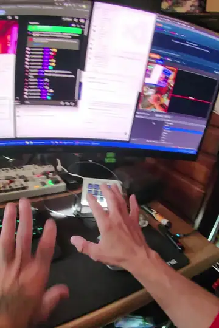
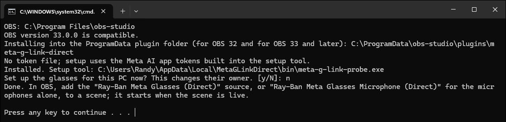
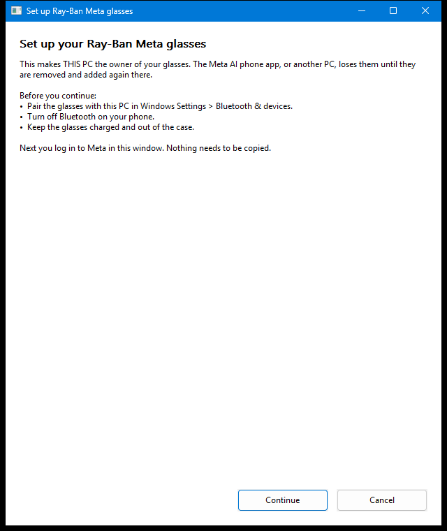
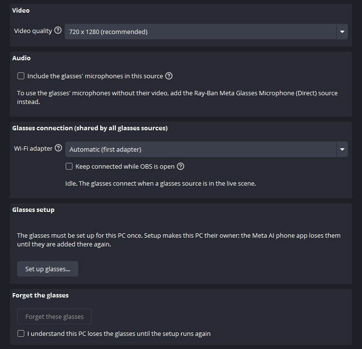
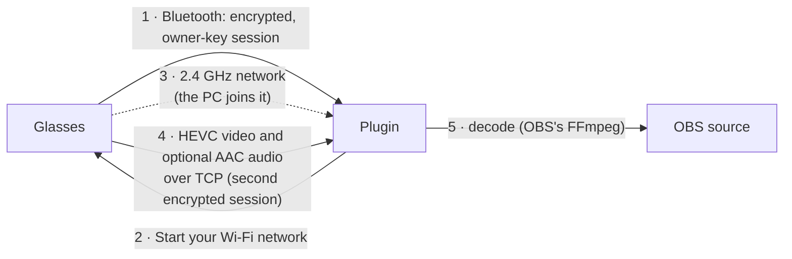

<p align="center">
  
</p>

<p align="center">
  <a href="https://github.com/RandyNorthrup/meta-g-link-direct/releases"></a>
  <a href="https://github.com/RandyNorthrup/meta-g-link-direct/releases"></a>
  <a href="https://github.com/RandyNorthrup/meta-g-link-direct/stargazers"></a>
  <a href="https://github.com/RandyNorthrup/meta-g-link-direct/actions/workflows/quality.yml"></a>
  
  
  <a href="LICENSE"></a>
  <a href="https://github.com/sponsors/RandyNorthrup"></a>
  <a href="https://www.paypal.com/donate/?hosted_button_id=Q9VC7B42R7K82"></a>
</p>

Use your **Ray-Ban Meta (Gen 2)** glasses as a first-person camera and microphone in **OBS Studio** on Windows. Video and audio come straight from the glasses over a short-range Wi-Fi network that the glasses create for your PC. No phone, no companion app, and no router or hotspot setup.

<p align="center">
  <br>
  <sub>Recorded in OBS with 0.3.1: 30 fps, 920 distinct pictures in 30.8 s. <a href="assets/glasses-30fps.mp4">Watch the full 30-second clip (MP4)</a>.</sub>
</p>

> [!WARNING]
> **Beta.** Tested on one Windows 11 PC with one pair of glasses. The one-time setup makes this PC the glasses' owner, which disconnects them from the Meta AI phone app. Read [Before you start](#before-you-start).

## Features

- **Live portrait video**: 720 × 1280 at 30 fps as a native OBS source.
- **Glasses microphones**: 48 kHz stereo, either as the camera source's own audio or as a separate microphone source that works with the camera off. Both are off unless you add or turn them on.
- **Direct link**: Bluetooth for control and the glasses' own 2.4 GHz Wi-Fi network for video and audio. Your home network isn't involved.
- **Hands-off**: the glasses connect when a glasses source goes live and disconnect when none is live. Quality and audio changes apply in 1–1.5 seconds without reconnecting. Starting and stopping never stall OBS.
- **Optional fast start**: with *Keep connected while OBS is open*, a source going live starts in about a second instead of about 13.
- **Hear OBS in your glasses**: OBS's audio monitor can play through the glasses' speakers while the camera streams ([how](#hear-obs-in-your-glasses)).
- **Battery on screen**: the glasses' battery level goes to a text file that an OBS text source or a Stream Deck key can show, and to obs-websocket clients ([how](#show-the-glasses-battery)).
- **Settings in one place**: every glasses source shows the shared connection settings, the battery level, *Set up glasses* and *Forget*. **Tools → Ray-Ban Meta Glasses (Direct)** opens them.
- **One-window setup**: you log in to Meta inside the setup window. Nothing to copy or paste.
- **Private**: Meta is contacted only during setup. The owner key is sealed to your Windows account. No telemetry, no update checks, no recordings.

## What you need

| | |
|---|---|
| **PC** | Windows 11 x64 |
| **OBS** | OBS Studio 32 or 33 (64-bit) |
| **Glasses** | Ray-Ban Meta Gen 2, charged |
| **Bluetooth** | An adapter that supports both Bluetooth LE and Classic |
| **Wi-Fi** | Any adapter that can join a 2.4 GHz network |
| **Account** | Your Meta account, for the one-time setup |

> [!NOTE]
> While the glasses are connected, the Wi-Fi adapter they use is on the glasses' network, and that link has no internet. If you stream online, connect the PC by Ethernet. With two Wi-Fi adapters you can give the glasses one of them in the **Wi-Fi adapter** setting and keep the other online; that setup hasn't been tested yet. Windows reconnects the adapter to your usual network when the glasses disconnect.

## Before you start

- **Ownership moves to this PC.** The glasses accept one owner. After setup, the Meta AI phone app can't use them until you remove and add them again in Meta AI. That return trip hasn't been tested by this project yet.
- **One PC at a time.** Setting the glasses up on another PC takes them away from this one.
- **Turn off your phone's Bluetooth** during setup and use, so the glasses don't connect to it.

## 1 · Pair the glasses with your PC

Do this once, before installing. The glasses must be paired with Windows itself, not only with your phone.

1. **Turn off Bluetooth on your phone**, so the glasses don't reconnect to it.
2. **Take the glasses out of the case** and make sure they're charged and on.
3. On the PC, open **Settings → Bluetooth & devices**, make sure Bluetooth is **On**, then choose **Add device → Bluetooth**.
4. **Put the glasses in pairing mode**: fold both arms, then press and hold the **capture button** (the button you press to take a photo) for about **12 seconds**, until the light inside the frame blinks **blue**. Let go as soon as it blinks.
5. In the Windows list, choose the glasses. They appear as **RB Meta** followed by four characters (for example "RB Meta 12AB"). Accept any prompt to connect or pair.
6. Check that **RB Meta …** now appears under *Bluetooth & devices*. "Paired" is enough; it doesn't need to say "Connected". After you power the glasses on later, you don't need to press Connect in Windows either: the plugin connects them itself when a glasses source goes live. The glasses must be awake (out of the case, unfolded).

If the glasses don't show up:

- Make sure your Bluetooth adapter supports **Bluetooth LE**. Older Classic-only adapters don't list the glasses at all.
- Put the glasses back in the case, close the lid for a few seconds, take them out and try pairing mode again.
- If they were paired with this PC before and setup now fails, remove **RB Meta …** in *Bluetooth & devices* and pair again.

## 2 · Install

1. Download `meta-g-link-direct-<version>-windows-x64.zip` from [**Releases**](https://github.com/RandyNorthrup/meta-g-link-direct/releases).
2. **Close OBS**, extract the zip, and double-click **`Install.cmd`**.
   The files aren't code-signed. If Windows SmartScreen says "Windows protected your PC", choose **More info → Run anyway**.
3. The installer finds OBS on any drive: the OBS that is running, the OBS installer's registry entry, Program Files, your per-user Programs folder and every Steam library. If it picks the wrong one, or finds none, pass the folder that contains `bin\64bit\obs64.exe`: `.\Install.cmd -ObsPath "D:\Apps\obs-studio"`.
4. It checks that the OBS is version 32 or newer with its FFmpeg libraries, copies the plugin to `%ProgramData%\obs-studio\plugins\meta-g-link-direct` (usually `C:\ProgramData\…`; the plugin location OBS recommends; a portable OBS gets it inside its own folder) and the setup window and setup tool to `%LOCALAPPDATA%\MetaGLinkDirect\bin`, then offers the one-time setup below. It prints the folders it uses, and asks for administrator permission only if a folder it has to change is protected.

<p align="center">
  
</p>

That folder holds the plugin in both layouts OBS uses. OBS 33 and later load the flat `meta-g-link-direct.dll`; OBS 32 loads `bin\64bit\meta-g-link-direct.dll`; OBS 33 skips the second copy. So upgrading OBS needs no reinstall, and OBS 32 and 33 can share a PC. Copies left by 0.1.0 in the old `obs-plugins` folder, which OBS 34 stops loading, are removed.

Optional: check the download against the `.sha256` file from the same release:

```powershell
Get-FileHash .\meta-g-link-direct-<version>-windows-x64.zip -Algorithm SHA256
```

## 3 · Make this PC the owner (one time)

When the installer asks *"Set up the glasses for this PC now?"*, answer **y**. The setup window opens:

<p align="center">
  
</p>

1. Read what the setup changes and select **Continue** (or **Cancel** to change nothing).
2. Log in with your Meta account in the same window.
3. The window then makes this PC the glasses' owner by itself and says when it's done. Keep the glasses on and nearby; it can take a minute.

To run the setup later, open any glasses source's properties in OBS and select **Set up glasses…** (the glasses link pauses while the window is open), or close OBS and run `.\Install.cmd -Setup` in the extracted folder.

The window shows the login with Microsoft Edge WebView2, which is part of Windows 11. If WebView2 is missing, the window offers to open the login in your browser instead and gives you a box to paste the final address into.

## 4 · Use it in OBS

1. In **Sources**, click **+** and add **Ray-Ban Meta Glasses (Direct)** for the camera, or **Ray-Ban Meta Glasses Microphone (Direct)** for the glasses' microphones alone.
2. Make its scene live. The first frame takes about 13–15 seconds, because the glasses start their Wi-Fi network and the PC joins it. In Studio Mode, the glasses start when the scene goes to **Program**, not Preview.
3. Switch away from the scene. When no glasses source is live, the glasses disconnect and your Wi-Fi adapter is free again.

<p align="center">
  
</p>

Every glasses source's **Properties** show:

- **Video quality** (camera source): 720 × 1280 (recommended), 1080 × 1920 (experimental), 504 × 896 or 360 × 640. Changes apply in about 1.5 seconds. All four have been checked in OBS; 360 × 640 runs at 24 fps, the others at 30.
- **Include the glasses' microphones in this source** (camera source): off by default. When on, the glasses' microphones become this source's audio in the OBS audio mixer (48 kHz stereo), where you can mute, adjust or route it like any source. The source always appears in the mixer and stays silent while this is off.
- The **microphone source** always sends the glasses' microphones. While only microphone sources are live, the camera stays off, and so does its light.
- **Glasses connection**, shared by all glasses sources (changing it in one changes it in all):
  - **Wi-Fi adapter**: *Automatic (first adapter)*, or a specific adapter by name. Pick the one you don't need online. If the chosen adapter is unplugged, the log says so and no other adapter is used. Changing it reconnects.
  - **Keep connected while OBS is open**: off by default. When on, the glasses connect as soon as OBS starts and stay connected with the camera off, so a glasses source starts in about a second. This uses the glasses' battery the whole time, and the Wi-Fi adapter stays on the glasses' network, with no internet, until OBS closes.
  - **Status** (Idle, Connecting, Connected with the camera off, Streaming, Reconnecting, Waiting, Failed or Stopped) and the **glasses' battery** level once the glasses report it.
- **Glasses setup**: **Set up glasses…** opens the setup window.
- **Forget the glasses**: **Forget these glasses** deletes this PC's owner key after you tick the confirmation under it.

Several glasses sources can be live at once. They share one connection to the glasses and show the same video; the camera source that went live first sets the quality.

### Hear OBS in your glasses

The glasses' speakers are an ordinary Bluetooth audio device in Windows, so OBS can play its monitored audio there: alerts, a music bed, or a browser source reading chat aloud, in your ear while you stream. This uses OBS's own settings; the plugin isn't involved.

1. In OBS, open **Settings → Audio → Advanced → Monitoring Device** and choose **Headphones (RB Meta …)**. Choose *Headphones*, not *Headset (… Hands-Free)*: the hands-free device is phone-call quality and can take over the glasses' microphone.
2. In the **Audio Mixer**, open a source's **Advanced Audio Properties** and set **Audio Monitoring** to *Monitor Only* (only you hear it) or *Monitor and Output* (you and the stream).

Monitored audio keeps playing while the glasses camera streams, and the video isn't affected: in a test, OBS held 30 fps with no skipped frames. Two things to know:

- **Media players pause.** While the glasses camera streams, the glasses send pause commands to Windows, so YouTube, Spotify and other media apps playing through the glasses keep pausing. OBS's monitor ignores those commands.
- **Bluetooth delay.** Bluetooth audio arrives a moment late. That's fine for alerts and music, but distracting for monitoring your own voice.

### Show the glasses' battery

While the glasses are connected they report their battery every 10–20 seconds. The plugin passes it on two ways. Without a connection the battery is unknown, so both show nothing rather than an old level.

**On screen, with a text file.** The plugin keeps `battery.txt` in its OBS settings folder: `%APPDATA%\obs-studio\plugin_config\meta-g-link-direct\battery.txt` (a portable OBS keeps it under its own `config` folder). It holds `87%`, `87% charging`, or nothing.

1. In OBS, add a **Text (GDI+)** source to the scene.
2. Tick **Read from file** and choose `battery.txt`. Paste the path above into the file dialog's name box; Windows fills in `%APPDATA%`.
3. Style it as you like. Put a second text source beside it if you want a label such as "Glasses".

The same file works for other tools that show a text file. For a **Stream Deck** key, a plugin that displays a file's contents can show it. For example, BarRaider's Text File Tools has a *Regex Display* action; the pattern `\d+%` shows just the percentage. This project hasn't tested any Stream Deck plugin.

**Through obs-websocket.** Tools that talk to OBS over obs-websocket, such as Streamer.bot (it has a *Vendor Event* trigger) or your own scripts, can use the vendor **`meta-g-link-direct`**:

- Request **`GetBattery`** (send it with `CallVendorRequest`) returns `{"available": true, "percent": 87, "charging": false}`, or `{"available": false}` when the battery is unknown.
- Event **`BatteryChanged`** (a `VendorEvent`) carries the same data each time the level, the charging state or the availability changes.

A tool can use these, for example, to warn you when the battery drops below 20%.

## Known limits

- **Battery**: streaming video drains the glasses quickly. One reading suggests about 35–40 minutes from a full charge at 720 × 1280 (not yet confirmed). Higher quality drains faster: in one test the battery fell 14% in about 3 minutes at 1080 × 1920 and 9% in about 3 minutes at 360 × 640. With only the microphone source live the camera is off; how much longer the battery lasts that way hasn't been measured yet.
- **Quality**: all four profiles have been verified in OBS: 720 × 1280, 1080 × 1920 and 504 × 896 at 30 fps, and 360 × 640 at 24 fps.
- **A short delay**: the glasses' radio sends video in bursts (several frames at once, then a pause of about 0.15 s). To show every frame at a steady 30 fps, the plugin holds each one briefly and plays it at its own time, so the picture runs about 0.2 s behind, more on an uneven link. The delay adapts to the link, between 0.02 and 0.5 s. Measured from the glasses' camera to OBS, the picture was about 0.4 s behind in total.
- **Audio sync**: audio is timed on the same clock as the video; in a clap test the two matched within one frame, so no *Sync Offset* is needed.
- **OBS 33** is verified with the 33.0.0 release candidate (rc2): installed, loaded from the new layout, video and audio streamed. The final 33.0 release hasn't been tested yet.
- **Reconnecting**: after a lost connection, video came back about 20 s later in a test. Walking out of range and back hasn't been tested yet.
- **Keyboard and screen readers**: every control in the properties and the setup window takes keyboard focus and has a name for screen readers. One exception comes from OBS itself: it names the **Video quality** and **Wi-Fi adapter** lists after their group (*Video*, *Glasses connection*), because OBS doesn't link a property's label to its control; each list still carries its description. High-contrast themes and 150–200% display scaling haven't been checked on a real display yet.
- **Security**: the PC doesn't yet verify the glasses' identity signature during the handshake.
- **Coverage**: one PC, one Bluetooth adapter, one Wi-Fi adapter and one pair of glasses. The glasses' firmware build hasn't been recorded yet.

## How it works



1. The plugin opens an encrypted Bluetooth session and proves it holds the glasses' owner key. If the glasses refuse the key, the source stops and asks for the setup again.
2. It asks the glasses to start their own 2.4 GHz / 20 MHz Wi-Fi network, with a fresh random name and password each time.
3. The PC joins that network with the chosen Wi-Fi adapter and a temporary Windows Wi-Fi profile.
4. A second encrypted session runs over TCP on that network. The glasses send what the live sources need: HEVC video, raw AAC audio, or both.
5. The glasses' radio delivers the frames in bursts, so the plugin times each frame and block of sound by its capture time plus a short delay. It decodes both with the FFmpeg libraries that ship with OBS and hands each frame to the live glasses sources when it is due, so OBS shows all 30 frames a second.

One connection serves every glasses source in OBS. When what the live sources need changes (quality, audio, camera on or off), the plugin stops the stream, configures it again and restarts it inside the same session, which takes 1–1.5 seconds. When no glasses source needs the glasses, the PC leaves the network and deletes the profile, and the glasses close the network within about 15 seconds.

Why do the glasses host the network? When the glasses instead joined a network (a Windows hotspot, or a home router), the video stopped within a minute every time. On their own network the stream holds. The details are in [the Wi-Fi link report](reports/WIFI_LINK_VERIFICATION.md).

## Troubleshooting

The OBS log (*Help → Log Files*) lists each connection step under `[meta-g-link-direct]`. While video flows it adds a line once a minute, for example *Video over the last 60 s: 30.0 fps from the glasses, 30.0 fps shown, presentation delay 188 ms, 2 late, 0 undecodable, 0 skipped.* A low "from the glasses" rate points at the Wi-Fi link; many "late" frames mean the link is uneven, and the delay grows to cover it.

| Symptom | What to do |
|---|---|
| The glasses don't appear when pairing | See [step 1](#1--pair-the-glasses-with-your-pc): the adapter must support Bluetooth LE, the phone's Bluetooth must be off, and the light must blink blue. |
| Stuck on *Connecting* or *Reconnecting* | Check that the glasses are on, charged and in range, and that your phone's Bluetooth is off. The source keeps retrying. |
| Status *Failed*, and the log says *No stored glasses identity* or *The glasses did not accept this PC as their owner* | Run the setup again: **Set up glasses…** in the source's properties, or `.\Install.cmd -Setup` (see [step 3](#3--make-this-pc-the-owner-one-time)). The second message means another PC or the phone took ownership since. |
| The setup window says it can't show the Meta login | Microsoft Edge WebView2 is missing or broken. Use the window's browser option, or install the WebView2 Runtime from Microsoft and open the setup again. |
| *This PC could not join the glasses' Wi-Fi network* | Make sure Wi-Fi is on and airplane mode is off. "No Wi-Fi adapter is available" means Windows sees no Wi-Fi adapter; "the Wi-Fi adapter chosen in the source properties is not available" means the selected adapter is unplugged, so plug it back in or pick another in **Wi-Fi adapter**. |
| *The glasses did not start their Wi-Fi network* | Their Wi-Fi may still be busy with an earlier session. The source retries; if it keeps failing, power-cycle the glasses. |
| Internet drops while the camera runs | The camera's Wi-Fi adapter is on the glasses' network (see [What you need](#what-you-need)). Use Ethernet, or try a second Wi-Fi adapter chosen in **Wi-Fi adapter** (untested). |
| *Waiting* | An earlier connection to the glasses in this OBS is still closing. The source continues on its own when it has. |
| Glasses audio moves the mixer meter but is missing from recordings or the stream | Check the source's tracks: *Edit → Advanced Audio Properties → Tracks*. 0.3.2 turns them on once for camera sources created with 0.1.0, which OBS had saved with every track off. |
| Internet stays off while OBS is open | *Keep connected while OBS is open* is on, so the Wi-Fi adapter stays on the glasses' network. Turn it off, or give the glasses a second adapter. |
| After OBS crashed mid-stream | The glasses close their network on their own within about 15 seconds. Delete any leftover `mgl-…` network in Windows Wi-Fi settings if one remains. |

To test the camera outside OBS, close OBS (or make sure it isn't connected to the glasses) and run the setup tool's 60-second stream check. It prints status lines and a frame count:

```powershell
& "$env:LOCALAPPDATA\MetaGLinkDirect\bin\meta-g-link-probe.exe" --stream
```

## Privacy and security

- The owner key and any imported Meta app tokens are sealed with Windows DPAPI for your account, in `%LOCALAPPDATA%\MetaGLinkDirect`. Nothing prints or logs them.
- Meta is contacted only during setup: the login and the ownership exchange. Streaming makes no Meta or internet call.
- The setup window shows Meta's own login page in a private WebView2 session and deletes that session's browser data when it closes. Your password goes only to Meta. The window reads only the one-time login code that Meta returns at the end, and uses it for the ownership exchange.
- The glasses' Wi-Fi network gets a new random name and 20-character password for every session.
- The glasses' microphones are used only while a live source asks for them: the microphone source, or a camera source with *Include the glasses' microphones* turned on.
- No telemetry, update checks or recordings. OBS's own recording stays under your control. Logs contain status lines only: no payloads, addresses or credentials.
- The battery file and the obs-websocket battery request stay on this PC. obs-websocket's own settings, including its password, decide who can connect.
- The setup window and setup tool have the Meta AI app's two public client tokens built in. They identify the app, not a person, and were already public.

## Uninstall and forget

- **Uninstall**: close OBS and double-click `Uninstall.cmd`. This removes the plugin and the setup tool and keeps the stored identity. It still removes the setup tool if OBS is already gone.
- **Forget the glasses**: in any glasses source's properties, tick the confirmation and select **Forget these glasses**. Without OBS, run `& "$env:LOCALAPPDATA\MetaGLinkDirect\bin\meta-g-link-probe.exe" --forget`; after uninstalling, delete `%LOCALAPPDATA%\MetaGLinkDirect`.
- **Give the glasses back to the phone**: in Meta AI, remove the glasses and add them again (not yet tested by this project).

## Build from source

See [docs/DEVELOPMENT.md](docs/DEVELOPMENT.md) for the toolchain, build commands, quality gates and project layout.

## Help and contributing

- **Questions and bugs**: [open an issue](https://github.com/RandyNorthrup/meta-g-link-direct/issues/new/choose). [SUPPORT.md](SUPPORT.md) lists what to include and what never to paste.
- **Security problems**: report them privately, as described in [SECURITY.md](SECURITY.md), not in a public issue.
- **Contributing**: see [CONTRIBUTING.md](CONTRIBUTING.md). Reports from other PCs, adapters and glasses firmware are especially useful.

## Support this project

If this project saves you time, you can [sponsor me on GitHub](https://github.com/sponsors/RandyNorthrup) or [buy me a coffee](https://www.paypal.com/donate/?hosted_button_id=Q9VC7B42R7K82) via PayPal. Thank you!

## Credits and license

- [**Visor**](https://github.com/macedonga/visor) by macedonga (AGPL-3.0): the AirShield/DataX session, Meta setup and stream protocol are ported from it.
- The glasses-hosted network messages (`CreateSoftApNetwork`) follow the Meta AI app's protocol definitions. No Meta code or binaries are included.
- OBS Studio's module API and the FFmpeg libraries that ship with OBS.

Licensed under the [GNU AGPL-3.0](LICENSE). Third-party details: [THIRD_PARTY_NOTICES.md](THIRD_PARTY_NOTICES.md).

This is an independent open-source project. It is not affiliated with, endorsed by or sponsored by Meta, Ray-Ban/EssilorLuxottica or OBS. Product names identify compatibility only.
